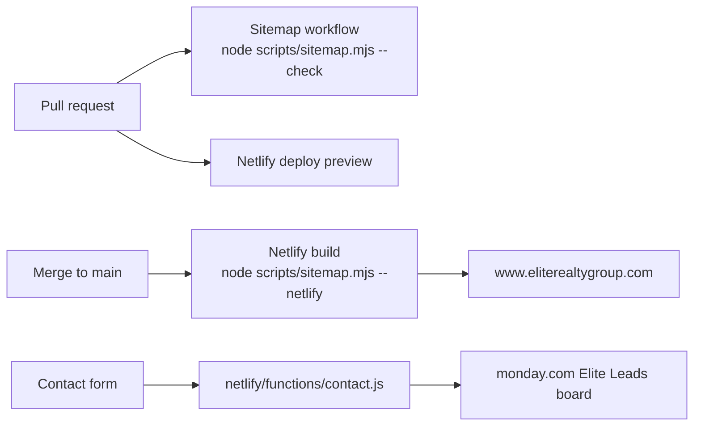

# Elite Realty Group website

Live at https://www.eliterealtygroup.com. Hand-built static HTML, hosted on Netlify (site ID `9bae3df5-53b3-42fd-aafc-5e45080b421f`). Merges to `main` deploy automatically.

## Layout

- `*.html`, `blog/*.html`: the pages. Served at clean URLs (`/about`, `/blog/`); `_redirects` 301s the `.html` forms.
- `css/`, `js/`, `images/`: shared assets.
- `netlify/functions/contact.js`: contact form handler.
- `_redirects`: legacy eliterealtygroup.com URLs and `.html` forms, 301 to current pages.
- `robots.txt`, `sitemap.xml`: for search engines. `sitemap.xml` is generated; do not edit it by hand.

## Adding a page

`sitemap.xml` is built by `scripts/sitemap.mjs` from the `.html` files in this repo. Every `.html` file is a page and must be in the sitemap, unless it is listed in `EXCLUDED` at the top of that script (with a one-line reason) or carries `<meta name="robots" content="noindex">`.

1. Add the page (for example `neighborhoods.html` or `blog/new-post.html`).
2. Run `node scripts/sitemap.mjs` and commit the updated `sitemap.xml` with the page.
3. A page that should stay out of Google (thank-you page, test page): add it to `EXCLUDED` instead, or give it a robots noindex meta tag.

The URL is the page's `<link rel="canonical">` if it has one (it must be on `https://www.eliterealtygroup.com`), otherwise the clean path (`about.html` becomes `/about`). `lastmod` is the last git commit that touched the file. The Netlify build regenerates the file with full git history, so dates stay real.

The `Sitemap` workflow fails a pull request when a page is missing from `sitemap.xml`, when `sitemap.xml` lists something that is not a page, when a sitemap URL is also a `_redirects` source, when `robots.txt` loses its `Sitemap:` line, or when `netlify.toml` / `_headers` sends an `X-Robots-Tag: noindex` header. The error says exactly what to change.

Excluded today: `faq.html`, `testimonials.html`, `careers.html`, `sitemap.html`. They were retired in the legacy-site migration (their URLs are in `_redirects`), but the files are still in the repo, and Netlify serves an existing file ahead of a non-forced redirect, so those URLs still answer 200.

## Google Search Console

LaunchEngine's site-monitor resubmits `sitemap.xml` to Search Console when it changes and alerts Slack when a sitemap page is not indexed within 7 days.

Follow-up: add `<meta name="google-site-verification" content="...">` to the `<head>` of `index.html` (there is no shared head template) once LaunchEngine has the token for this site. Until then the indexing job cannot act on this site.
